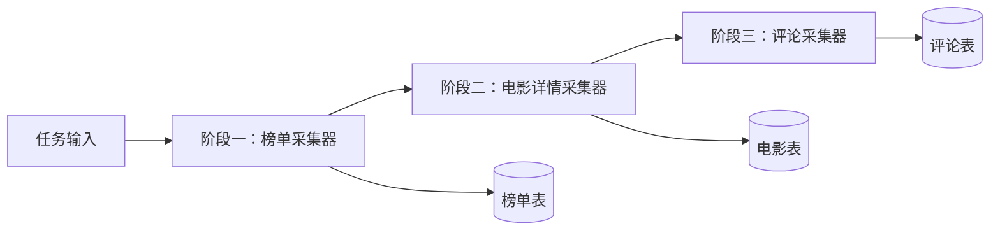

# scrapio 采集器独立化与任务编排优化设计方案

> 状态：待评审设计方案。本轮只整理产品与技术设计，不修改代码、数据库、已有任务或数据，不代表下述能力已实现。
>
> 日期：2026-10-12。适用场景：自用或小团队、单实例部署，核心架构继续为 Go 控制平面 + scrapio-browser + PostgreSQL。
>
> 核心决策：**采集器是独立的输入到输出处理能力；任务是编排好的采集流程；运行是任务的一次执行。** 列表、详情、评论是采集器的业务用途，不再是平台限定的页面角色。
>
> 与原方案的关系：本方案调整 v2.2 的产品模型，替代原规划中固定“列表 → 详情”、详情字段归属列表路径、采集方案直接承担调度及整条链路执行的设计。既有 v2.2 文档和开发记录保留，作为当前实现的历史依据；新模型相关的后续设计以本文为准，其他内容逐项核对后复用。不在本轮指定新的版本号。
>
> 相关文档：[产品规划与需求](采集平台v2.2产品规划与需求.md)、[动态数据表与记录模型](动态数据表与记录模型.md)、[前端重设计](前端管理界面v2.2重设计.md)、[接口落地待办](采集平台v2.2接口落地与页面对接待办清单.md)。
>
> 独立落地待办：[采集器独立化与任务编排分阶段实施 TODO](采集器独立化与任务编排分阶段实施TODO.md)，按 O0～O5 拆分设计、后端、浏览器、前端和发版验收；不继承旧清单的完成状态。

## 1. 问题与目标

当前列表、详情、返回列表和翻页被放在同一份采集定义中。它能表达一类常见路径，但将以下概念绑在了一起：

- 如何获取一个页面及其字段。
- 从哪里得到下一批采集输入。
- 一个业务目标包含几个采集阶段。
- 哪个阶段写哪类结果，失败后应该补采哪部分。

真实需求可能是“榜单 → 电影详情 → 评论”，也可能是“搜索接口 → 商品详情 → 商品问答”，或从现有数据表直接获取一批详情。它们需要独立配置、复用和重试，不能不断向详情路径里叠加更多固定层级。

本方案要让用户完成四件事：

1. 为一种输入配置并验证一个独立采集器。
2. 将多个采集器连接成任务，明确每个阶段的输入、输出和处理条件。
3. 从手动输入、文件或数据表启动任务，得到可查询、可追溯的结果。
4. 在部分失败、重启和数据更新后，明确选择续跑、补采或重新运行。

本轮设计重点是输入、编排与执行模型。已有多样本点选和浏览器画面体验仍有价值，但不能代替这次模型调整。

## 2. 产品对象与统一术语

| 对象 | 用户含义 | 负责的内容 | 不应承担的内容 |
| --- | --- | --- | --- |
| 采集器 Collector | 能处理一类输入、产出一类数据的工具 | 输入契约、访问与操作步骤、提取/清洗/校验、输出契约、样例与版本 | 整个业务流程的阶段连接、定时计划 |
| 任务 Task | 已编排的采集流程 | 输入来源、阶段、连接映射、保存目标、预算、调度及触发 | 每个网站元素的定位规则 |
| 阶段 Stage | 任务中使用某个采集器的位置 | 固定采集器版本、阶段参数、输入映射、输出绑定、执行策略 | 隐式读取采集器最新版 |
| 数据表 Data Table | 一类长期保存的业务记录 | Schema、唯一键、查询、变化与来源 | 自动触发所有读取该表的任务 |
| 运行 Run | 一次试采或正式执行 | 冻结版本/输入范围、进度、结果、错误与恢复操作 | 在执行中跟随草稿变化 |
| 工作项 Work Item | 一个可独立执行和恢复的输入单元 | 输入快照、来源、执行尝试、租约、分页检查点 | 等同于一条输出记录或一次页面请求 |
| 运行输出 Run Output | 这次执行产生的确定结果 | 已校验值、版本、保存决策、上游来源、下游分发依据 | 等同于随时变化的数据表当前值 |

对用户的主导航只呈现任务、采集器、数据和运行。工作项、租约、分发记录是运行详情及诊断中的概念。

同一采集器可以在多个任务中使用，也可以在同一任务的不同阶段中使用。每个阶段有独立标识，不能用 collector_id 代替 stage_id。

### 2.1 单采集器也可以方便运行

单独试用采集器时提供“测试一个输入”，不要求先创建任务。需要正式执行、批量处理或定时时，提供“创建单阶段任务”，预填采集器、输入和建议数据表；确认后仍形成正常任务对象，不维护第二套正式执行机制。

采集器可以建议保存到某个数据表，但最终保存绑定属于任务阶段。采集器发布时确认输出字段契约，任务发布时确认具体数据表、字段映射与写入策略。这样同一采集器才能在不同任务中复用。

## 3. 两层流程：采集器内部与任务阶段之间

### 3.1 采集器内部执行

采集器处理一个输入，其步骤可以包括：

```text
解析输入 → 打开网页/请求接口 → 操作与等待
       → 定位当前记录 → 提取与转换 → 校验并产出
       → 有界翻页/加载更多 → 继续提取 → 结束
```

步骤按实际需要组合，允许单页、列表和 JSON 数据，不要求存在详情入口。访问方式可以是 HTTP HTML、HTTP JSON 或浏览器；它们共享输入、输出、版本、预算和错误契约。

一个工作项可以产生零条、一条或多条结果，也可能访问多页。分页是采集器内部的有界循环，不将每一页自动显示成任务阶段。

网页操作可以导航到目标采集页，但首版不在同一采集器内增加任意嵌套的“发现每条链接 → 再抓每个对象”循环。需要独立处理的一批新对象，通过输出字段交给下一个采集器。将来扩展内部循环也必须声明范围与预算。

### 3.2 任务阶段连接



图中 A→B、B→C 表示本次运行输出到下游输入的显式映射，不表示下游通过轮询整张表发现新数据。数据表用于长期保存，本次运行输出用于可靠衔接。

拆分依据是独立输入、规则、输出、生命周期与重试价值。例如榜单翻页保留在榜单采集器中，电影详情和评论具有独立数据与失败范围，应拆成采集器。

### 3.3 首版编排范围

首版支持单入口、有限阶段的无环流程；一个阶段可以连接多个下游分支，每个非入口阶段只有一个上游。连接支持逐条映射、声明数组展开和简单过滤。

不支持跨阶段回环、多上游 Join、批量聚合、自定义 SQL、任意脚本节点或无限递归。这些能力后续按真实需求增加，不能成为创建三阶段任务的前置负担。内部有界分页不受无环阶段结构限制。

## 4. 验收场景：豆瓣 Top250 → 电影详情 → 评论

| 阶段 | 输入 | 采集器执行 | 输出 | 保存目标与唯一键 |
| --- | --- | --- | --- | --- |
| 榜单 | Top250 入口 URL、采集范围 | 打开榜单，提取记录并分页 | 排名、名称、movie_id、detail_url | 榜单表；榜单标识 + movie_id |
| 电影详情 | url、movie_id、可选排名 | 打开详情并提取电影信息 | movie_id、名称、导演、上映信息、评分、comments_url | 电影表；movie_id |
| 评论 | url、movie_id、页数/评论预算 | 打开评论列表，提取并分页 | movie_id、comment_id、作者、评分、正文、时间 | 评论表；movie_id + comment_id |

入口地址为 `https://movie.douban.com/top250`。字段存在性、详情/评论入口、评论类型及登录要求需在真实站点验证，表中字段为设计样例，不宣称已有规则能直接获取全部数据。评论任务必须明确选择短评或长评等具体对象。

阶段连接配置示例：

```text
榜单 → 电影详情
  url      ← output.detail_url
  movie_id ← output.movie_id
  rank     ← output.rank
  条件：detail_url 非空

电影详情 → 评论
  url      ← output.comments_url
  movie_id ← output.movie_id
  条件：comments_url 非空
```

三张表不强行合并。评论通过 movie_id 与电影建立业务关联，平台另保留执行来源关系；业务关联键不能替代工作项来源。

电影详情成功后可立即推进该电影的评论，不必等待全部电影详情完成。一部电影失败，默认继续其他工作项并保留失败输入，最终报告部分成功。用户也能从电影表选十部电影，创建单阶段评论任务。

同一电影同时出现在多个榜单时，业务唯一键可将电影保存为同一条记录；不同榜单来源继续保留。是否减少重复访问另由工作项去重策略决定。

## 5. 输入来源、契约与映射

### 5.1 采集器输入定义

输入是结构化数据，不限定为 URL。每个输入字段声明稳定字段键、显示名、类型、必填/默认值和用途，例如：

```json
{
  "url": "https://movie.douban.com/subject/1292052/",
  "movie_id": "1292052",
  "rank": 1
}
```

网页/接口地址、查询参数、请求体与输入动作可以使用这些字段。首版映射支持字段引用、常量及受限字符串模板；不执行表达式中的任意 JS，不允许未声明字段暗中进入请求。

明确缺失、null、空字符串和类型不符的差异。必填字段不通过时，工作项在访问网站前结束为输入无效，并指出哪个来源字段无法映射。

### 5.2 任务输入来源

| 来源 | 创建工作项的方法 | 必须明确的范围 |
| --- | --- | --- |
| 手动输入 | 一条或少量结构化输入转换为入口工作项 | 条数、输入类型及校验结果 |
| 地址列表/文件导入 | 预览列映射后逐行生成输入 | 文件版本、有效/无效/重复行、导入上限 |
| 数据表查询/勾选记录 | 将指定记录值映射为入口输入 | 表及 Schema、条件、选择范围、版本快照 |
| 上游阶段输出 | 每个符合条件的输出按连接映射生成工作项 | 上游阶段、输出契约、过滤与展开规则 |

数据表查询是任务启动时的一次有限输入选择，不是持续订阅。每条输入在形成工作项前持久化快照和来源记录版本。大批量输入可分块物化，但必须使用可重现的数据库快照或等价版本边界，不能仅靠 updated_at 截止条件实现“快照”。技术方案需在实施前验证。

选取历史运行输出作为补采输入时，使用原输出快照，不重新读取当前表值。证据已过期或被删除时，明确提示无法精确复现，不能悄悄改用最新值。

### 5.3 连接映射与展开

映射界面使用“目标输入字段 ← 来源字段”，提供真实样例和类型检查。例如 movie_id 可以来自当前输入或提取字段，再通过采集器输出显式透传；不隐式继承整条祖先记录。

默认一条上游输出产生一个下游工作项。数组字段只有选择“逐项展开”才产生多个输入；展开元素和关联父字段共同组成快照。空数组、空链接和不满足条件分别记录为已过滤，不伪装成下游失败，也不因过滤而抹掉上游结果。

过滤先支持非空、相等/不等、包含和简单组合，使用声明字段并执行类型校验。“最近七天已成功则跳过”等增量规则属于执行策略，不与普通字段过滤混在一起。

### 5.4 输入不会自动扩大访问范围

采集器声明允许访问的来源与能力，任务可以收窄，不能凭上游给出一个新 URL 自动扩大允许域名。重定向仍按实际请求和最终地址检查；需要同站安全跳转等例外时显式声明并验证，输入映射不能绕过该检查。

需要登录的采集器引用凭据配置。传递的是 credential_ref 等受控引用，不是 cookie、密码或浏览器页面状态。上下游不直接共享编辑会话、DOM 引用或 page_state_id。

## 6. 独立采集器的执行与输出

### 6.1 编辑和测试

编辑器以一个样例输入起步，直接打开这个采集器的目标页面。电影详情字段在详情页面配置，评论字段在评论页面配置；无需先走列表、详情入口及返回列表。

工作台建议组织为：

```text
输入与样例 → 获取与页面操作 → 记录与字段
          → 分页/结束条件 → 输出与校验 → 测试与发布
```

不是所有目标都需要分页和页面操作。网页点选只保留“选记录、选字段、选分页元素”等与当前采集器有关的操作；下一阶段链接作为普通 link 字段提取，任务连接时选择该字段。CSS/XPath、JSONPath 与多样本校准继续保留。

需要多个步骤才能到达采集页面的站点，可在采集器内部配置有界导航和动作。只有点击才能到达、无法生成稳定下游输入且必须共享活跃会话的站点，不假装已被独立 URL 采集覆盖；此类能力作为明确扩展项验证。

### 6.2 输出契约与保存绑定

采集器输出契约定义字段键、类型、必填、多值和清洗规则，不绑定“list/detail”角色。首版每个采集器有一个结构化记录输出端口，可以产出多条记录。

任务阶段将输出端口绑定到一个逻辑数据表，确认字段映射、Schema 版本、唯一键与更新策略。每个阶段可以保存到不同的表；同一采集器在其他任务中可以绑定其他兼容表。多个阶段写同一表时需要检查字段兼容、共享键和覆盖策略；首版不允许未经定义的并发字段合并。

正式阶段首版要求绑定数据表，中间榜单结果也可靠保存。仅传递不保存、多个命名输出端口和一个阶段同时写多张表作为后续能力，不因当前缺少多输出机制重新绑死成列表/详情。

### 6.3 输出有三种不同含义

| 层次 | 含义 | 能否直接驱动正式下游 |
| --- | --- | --- |
| 原始候选 | 解析/提取出来但尚未通过校验的数据 | 不能 |
| 本次运行输出 | 已校验、已持久化且有保存决策的这次产出 | 可以，按任务连接策略 |
| 数据表当前记录 | 按业务唯一键合并后的最新业务状态 | 只在显式数据表输入任务中使用 |

下游默认使用本次输出的规范化值，不使用写入时与旧数据合并后的当前表值。这样本次缺失字段不会从旧记录中“补出”链接并意外访问。如果要使用现有完整数据，应显式选择数据表输入。

created、updated、unchanged 是保存决策，invalid、conflict 是不能正常入库的结果；它们与工作项成功/失败不同。默认允许有效的 unchanged 输出继续向下游传递，否则每次榜单没变化就无法更新评分或评论。仅新增、仅变化或定期刷新可作为明确连接/执行策略选择。

### 6.4 零结果与分页

“没有评论”可以是成功的零输出，但必须符合已配置的结束条件，并有页面/响应证据。规则失配、登录页、验证码或异常空页面不能一律解释成成功。

分页配置必须包含最大页数/结果数/时长、结束条件及重复页检测。评论采集的一条电影输入可以遍历多页，每完成一页保存结果和检查点；达到人为预算显示 limited，而非完整成功。

## 7. 任务编排、发布与试采

### 7.1 任务定义

任务包含：名称、输入来源、阶段与连接、阶段保存绑定、并发/访问预算、错误策略、重叠运行策略和触发设置。

阶段引用具体采集器发布版本。新增采集器版本不改变已有任务；任务编辑器显示可升级版本，用户查看输入/输出兼容性及样例差异后显式升级并重新发布。

首版不设置“运行时永远使用最新版”。正在运行的任务固定任务版本、采集器版本、Schema、映射、过滤、策略与输入范围。调度时间可以独立调整并留审计记录，不能借调度变更修改冻结的执行定义。

### 7.2 发布检查

发布前至少检查：

- 阶段引用存在且可执行，连接无环，阶段标识唯一。
- 每个目标必填输入都有明确来源，类型、数组展开和常量合法。
- 各阶段输出有兼容保存绑定及明确唯一键。
- 浏览器/HTTP 能力、凭据、访问范围与预算可用。
- 零输出、部分失败、增量跳过与重叠运行策略已显示。
- 各采集器样例通过，完整任务试采覆盖连接与来源传递。

如果已绑定 Schema 在运行前或运行中变得不兼容，停止受影响工作项并解释，不按最新 Schema 偷偷转换。允许继续写旧 Schema 的兼容策略须另行批准，不能作为默认假设。

### 7.3 两类测试

**采集器测试**：用一条/少量输入检查获取、提取与输出契约，可实时访问，也可用固定快照；不创建正式任务，不写正式数据表。

**任务试采**：用少量入口输入走完整阶段，持久化受限的试采输出并驱动下游试采工作项，展示每阶段预期保存决策；不写正式数据、不触发插件外部交付。

实时试采会访问网页，离线试采只能验证已提供快照覆盖的步骤。缺失下游页面证据时报告未覆盖，不能假通过。评论试采达到页数预算时必须显示有界验证，不声称采完全部评论。

## 8. 持久化执行、队列与完成条件

### 8.1 总体执行路径

```text
触发任务 → 冻结版本与输入范围 → 生成入口工作项
        → worker 领取 → 独立执行采集器
        → 校验输出/写表/保存来源/登记分发
        → 分发器生成下游工作项 → 下游继续执行
        → 所有阶段关闭输入且处理完毕 → 汇总运行结果
```

首版使用 PostgreSQL 持久队列，Go worker 领取带租约的工作项，单实例也应支持多个并发执行槽。HTTP 与浏览器工作项按能力及资源限制调度，不增加 Kafka、Redis 或独立工作流集群作为前置依赖。

### 8.2 保存与派发的事务边界

网页访问发生在数据库事务外，不持有长事务等待浏览器。

一个结果批次的当前记录更新、观察/运行输出、来源关系、下游待分发记录及本批检查点，应在同一数据库事务中提交。下游待分发采用事务 outbox；分发器后续将其转换为工作项并记录完成。进程在提交后、分发前重启，仍能继续生成下游。

分发消费允许重复尝试，依靠唯一约束保证不重复形成同一个下游工作项。批次中无效/冲突候选保留诊断，但不建立可消费输出；异常数据库写入不能留下“上游成功但结果没保存”的状态。

工作项结束前必须保证最后一批结果、检查点和分发登记已提交。具体物理表可合并实现，但事务语义不能省略。

### 8.3 去重与幂等分层

| 边界 | 建议标识 | 解决的问题 |
| --- | --- | --- |
| 任务触发 | 用户/任务/触发请求键 + 请求指纹 | 网络重试重复创建运行 |
| 根输入 | run_id + 入口输入标识 | 输入物化重试重复创建工作项 |
| 下游派发 | run_id + edge_id + output_id + 展开元素标识 | 分发器重复处理同一来源 |
| 工作项输出 | work_item_id + 稳定结果标识 | 分页恢复或执行重试重复提交同一结果 |
| 业务记录 | table_id + canonical_key | 多次运行保存同一电影/评论 |

执行 attempt 不直接作为结果幂等键；数组展开标识需要由冻结数组顺序或稳定元素键确定。站点结果身份优先使用业务键与稳定页面标识，不能把当前 DOM 序号当作跨重试身份。

下游派发键解决同一来源的重复消费，不会自动合并两个不同来源产生的相同 URL。首版保留各来源工作项；同一运行内按规范化输入合并重复访问是后续优化，必须保留全部来源关系和相关统计。

不承诺网站访问恰好一次。网络请求、浏览器动作与数据库无法组成分布式原子事务；已知只读操作可按预算重试，未知网页动作先查回执。提交表单、发送等有外部副作用的动作不能凭租约到期盲目重放。

### 8.4 租约、恢复和取消

工作项至少保存状态、执行尝试、下次重试时间、lease_owner、lease_until、租约令牌、冻结输入和检查点。领取与提交都校验有效令牌，旧 worker 不能在租约转移后继续提交结果。

重启后恢复工作项队列及未分发输出，不恢复失效 DOM 引用。可恢复分页地址/游标从检查点重新打开并验证；点击式分页没有可靠恢复路径时明确需要从工作项起点重采，已提交结果依靠幂等保护，不能宣称精确续页。

未知动作无法通过查询确定结果时，工作项进入 awaiting_confirmation，停止该项自动重试/推进，展示原动作编号和恢复入口；用户或可靠回执确认后才能恢复。等待确认是活动状态，不得按完成项关闭阶段。

暂停停止领取新工作项，已执行项在安全检查点停止或完成；界面在生效前显示“暂停中”。取消停止新派发及领取，处理正在执行的取消请求，已提交数据保留，并记录未处理范围。不能把排队时取消与远端未知动作混为一谈。

### 8.5 阶段结束条件与背压

队列暂时为空不等于阶段完成。阶段需要同时满足：

1. 所有来源已结束，不会再产生新输入。
2. 来自上游的 outbox 已消费或因取消明确终止。
3. 没有 queued/running/retry_wait/awaiting_confirmation 等活动工作项。

入口输入物化完成后才关闭入口；上游完成且分发耗尽后才能关闭下游输入。阶段关闭与派发使用事务/锁保证一致，不能出现“下游已完成，上游又派来输入”。取消、上游失败或受限结束会携带关闭原因传递，不能让下游永远等待。

工作项分页较长时，下游仍可按已提交输出推进。错误策略为整阶段暂停时，只能停止后续推进，无法撤回此前已经保存或处理的数据，运行界面应明确这点。

队列、输出总量、单阶段并发、单站点速率、页数、时长和存储都有预算。达到待处理容量时暂停上游推进/派发并显示积压；分发器需按事务预算分块处理大数组，不能先无限写 outbox 再称已实现背压。阶段按资源公平领取，长评论任务不能长期独占浏览器。

## 9. 增量更新、失败策略和补采

### 9.1 新运行与旧工作项重试

- 同一工作项重试：固定原输入及版本，增加 attempt；已提交结果不重复派发。
- 新一次任务运行：重新选择入口输入并形成新的 run_id，业务记录可以更新；它不受上一运行派发键阻止。
- 补采失败项：创建新的补采运行，引用原失败工作项和原输入快照，默认复用原版本；独立记录新的结果和已选范围。
- 修复后补采：发布新采集器/任务版本，预览输入兼容与影响后创建新运行；不替换旧运行版本。

若从中间阶段开始补采，其来源可以是历史运行输出快照或数据表显式查询。界面标明“从电影详情阶段开始，榜单阶段未执行”，不能把局部补采报告成完整流程回归。

### 9.2 默认错误策略

默认“失败隔离并继续其他项”，重试有次数和时间预算。输入/Schema/规则错误不无限重试；网络或短暂服务不可用可以退避重试；凭据失效、能力不可用等共享错误暂停相关阶段，避免对所有输入重复失败。

下游只消费已成功持久化的有效输出，invalid/conflict 不派发。一个工作项在后续页失败前可能已经有成功输出，应报告部分产出及未覆盖范围；不能因终态 failed 就将此前成功数据删掉。

### 9.3 数据变化与刷新策略

连接默认消费本次有效输出，包括 unchanged。可显式改为“仅新增”“仅变化”，但需说明会跳过旧电影后续信息刷新。更精细的“距离同一输入最近成功超过七天才执行”后续按输入指纹、采集器版本/策略和成功历史实现，不能只看数据表 updated_at。

首版定时计划触发有限任务运行，默认同一任务不重叠执行，触发被跳过或排队必须可见。允许并行运行时需另外定义多写入冲突策略。首版不支持数据库变化的持续订阅；未来订阅使用持久事件/游标及回补机制，不以每秒扫描整表或仅按更新时间分页代替。

### 9.4 状态与统计

| 对象 | 建议状态 | 说明 |
| --- | --- | --- |
| 工作项 | queued / running / retry_wait / awaiting_confirmation / succeeded / partial / failed / limited / skipped / cancelled | awaiting_confirmation 阻止未知动作重放；partial 表示有可用输出但存在失败范围；limited 表示预算限制 |
| 阶段 | waiting / running / pausing / paused / succeeded / partial / failed / limited / cancelled | 阶段状态结合输入关闭和工作项汇总 |
| 运行 | queued / preparing / running / pausing / paused / succeeded / partial / failed / limited / cancelled | preparing 明确输入物化阶段，不能长期只显示排队 |

正常终态的汇总顺序应固定：存在错误且有成功范围为 partial；存在错误且没有成功范围为 failed；没有错误但存在预算截断为 limited；其他已完成范围为 succeeded。零输出但满足结束条件可以 succeeded，不能用输出数是否为零单独决定状态。取消独立为 cancelled，暂停不是终态。

统计分别展示输入条数、工作项成功/失败/跳过、候选数、有效输出数、保存 created/updated/unchanged/invalid/conflict 数和下游已派发/待分发数。展开和分页导致这些数量不同，不要求跨阶段条数相等。

## 10. 通用数据模型建议

业务数据继续采用逻辑数据表 + Schema 版本 + JSONB 记录 + 观察/修订。下表是逻辑实体建议，不是冻结 DDL 或要求照此新增全部物理表。

| 实体 | 关键字段/内容 | 主要约束 |
| --- | --- | --- |
| collector / collector_version | 输入 Schema、获取方式、步骤、输出 Schema、能力/访问要求、解释器版本 | 发布版本不可变 |
| task / task_version | 阶段、连接、输入配置、预算、写入绑定、错误策略 | 发布时校验连接，阶段与边标识稳定 |
| task_schedule | 计划、暂停状态、触发记录 | 调度引用确定任务版本 |
| task_run | 冻结清单、触发来源、状态、输入物化边界、retry_of | 原运行不被新版本覆盖 |
| stage_run | 阶段版本、输入关闭状态、进度与统计 | run_id + stage_id 唯一 |
| work_item / work_attempt | 输入 JSONB、来源、状态、租约/令牌、检查点、尝试及错误 | 同来源派发唯一、提交校验租约 |
| run_output | 工作项、输出身份、规范化值、Schema、观察/记录引用、保存决策 | work_item_id + output_identity 唯一 |
| output_dispatch | 输出、连接、展开元素、待分发状态、下游工作项 | output_id + edge_id + expansion_identity 唯一 |
| lineage | 来源输入/输出/记录版本、目标工作项及映射版本 | 可追溯多个来源，业务关联与执行来源分开 |
| data_table / schema_version / record / observation / revision | 业务字段、唯一键、当前值、采集证据和变化 | table_id + canonical_key 唯一 |
| run_event | 运行与阶段/工作项标识、事件序号、错误和进度 | 有序分页、断流可恢复 |

任务版本需要冻结各阶段实际表映射及 Schema，不仅保存采集器 ID。输入/输出 JSONB 有大小与条数限制，网页原文和截图作为受保留期约束的证据，不塞进每个下游输入。

观察可以承载本次运行输出快照；是否新增 run_output 物理表取决于现有观察是否满足输出身份、批次提交、派发和保留语义。不能只加一个 record_id 就让下游读取当前表。

运行、工作项、输出、分发和来源关系优先使用固定列索引；业务 JSONB 按查询需求增加受控索引。删除采集器、任务或表前检查发布引用、活动运行和来源保留期，优先归档；清理证据后界面明确哪些复现能力失效。活跃分发所需输入输出不可提前清理。

## 11. 服务职责与拟议接口

### 11.1 服务边界

| 组件 | 职责 |
| --- | --- |
| scrapio Go | 采集器/任务配置、发布校验、输入物化、阶段调度、工作队列、HTTP 执行、结果校验保存、分发、追溯与调度 |
| scrapio-browser | 编辑会话、画面/点选、网页动作与回执、独立运行会话、获取页面/响应及受控凭据应用 |
| PostgreSQL | 版本/配置、工作项、租约、输入输出、业务记录、事务 outbox、来源与运行事件 |
| web | 采集器编辑、任务编排、输入映射、试采、数据查询、运行诊断与补采 |

浏览器不决定业务任务的下游，不负责保存业务数据表。任务层传递 JSON 输入与结果，网页 DOM 引用不离开当前采集器会话。凭据可在授权范围内复用，活跃标签和会话不能并发共享来冒充独立执行。

### 11.2 接口分组草案

以下只描述资源职责，不承诺已有 URL，也不冻结采用新 API 前缀或扩展 v3 的方案。

| 分组 | 拟议能力 | 页面使用位置 |
| --- | --- | --- |
| 采集器 | 草稿、输入/输出契约、样例、测试、版本、发布 | 采集器列表与工作台 |
| 任务 | 草稿、阶段、连接、映射样例、输入预览、输出绑定预演、试采、发布 | 任务列表与编排页 |
| 触发 | 手动/API 创建运行、查询原请求、计划与重叠策略 | 任务概览与调度 |
| 运行 | 汇总、阶段、工作项分页、输入/输出/来源、事件、暂停/取消/补采 | 运行中心 |
| 数据 | 表/Schema、记录、观察、查询、导出、选记录生成任务输入 | 数据工作区 |

创建/发布/触发/补采使用请求幂等键与指纹；草稿保存带 expected_revision。异步输入物化、试采和正式运行返回可查询标识，不让 HTTP 请求一直等待整条流程完成。事件断流后查询原运行，不自动创建第二次执行。

错误反馈定位到“任务 / 阶段 / 工作项 / 输入字段或执行步骤”，区分输入映射失败、采集规则错误、保存冲突和下游派发积压。例如“评论阶段的 url 未映射：来源 comments_url 为空”，不能统一提示“定位规则无效”。

## 12. 前端信息架构与交互设计

### 12.1 导航与首页

```text
首页
任务          业务采集目标、编排、计划、运行
采集器        可复用采集能力、样例、版本
数据          业务数据表、查询与导出
运行          阶段进度、工作项、失败与补采
设置          浏览器、凭据、容量
```

首页主要显示任务进度、需要处理的失败和最近数据；“新建任务”是主动作，“制作采集器”为辅助入口。新用户可选择“从一个网址开始”，创建采集器并测试，再以单阶段任务确认正式执行。不要首屏要求理解所有内部对象。

### 12.2 采集器工作台

标题示例“电影详情采集器”，顶部是样例输入和版本状态。浏览器/JSON 预览继续占主要空间，输入、操作、字段、分页及输出以分区呈现；采用规则只修改当前采集器。

输出预览可以加入输入字段，使用“来自输入”的显式来源标记，避免用户为了保留 movie_id 再从网页重复提取。测试结果显示每个输入产生多少结果、访问多少页、结束原因及字段值。

不再常驻“详情路径”“详情字段”“返回列表”区域。获取详情/评论链接使用普通链接字段，页面语义由采集器名称和样例决定。多样本点选仍用于当前页面的同类记录校准。

### 12.3 任务编排页

首版采用阶段卡片与连接配置，线性流程默认纵向排列，分支可缩进展示；不以复杂画布为前置。

每个阶段卡片展示采集器及版本、输入来源摘要、保存数据表和验证状态。选中阶段后只编辑该阶段配置，提供“编辑采集器”入口，不能在任务页面复制一套字段编辑器。

连接配置提供字段映射表、过滤和展开选项，右侧显示一条来源样例转换出的下游输入及错误。发布前展示全任务访问范围、预计工作项、每阶段保存目标和去重策略。

增加阶段时可选已有采集器或创建新采集器。一个输出端口可以连接多个分支，例如电影详情分别接评论采集器和演职员采集器，不要求增加新的固定页面角色。

### 12.4 数据表与运行详情

数据表支持勾选记录后“交给采集器处理”，预览映射并创建单阶段任务；已有记录不会仅因点击查看就触发采集。

运行详情首先展示业务摘要，再展示阶段进度。阶段行显示输入、成功/失败/跳过、输出、保存决策和待分发数量；失败展开到具体工作项，可查看冻结输入、页面证据和来自哪个上游结果。

操作区区分“继续原运行”“补采失败输入”“用修复版本创建补采运行”“重新执行整个任务”。每个操作说明使用版本、输入范围和写入影响，使用现有模板组件确认，不用一个“重试”按钮代替全部语义。

部分失败、零输入、零输出、上游受限、下游尚无输入、容量暂停和服务不可用都有独立空态。下游等待上游时显示“等待榜单输出”，不只显示排队。

## 13. 业界设计参照与取舍

| 参照 | 常见模型 | 可借鉴之处 | 本项目取舍 |
| --- | --- | --- | --- |
| Scrapy | Request 队列、解析回调、生成后续 Request、输出 Item | 请求输入与结果分离，动态发现目标 | 将代码回调关系表达为可验证的阶段连接 |
| Apify 类平台 | 独立采集程序、输入、Dataset、Request Queue 与调用集成 | 独立采集器、数据和目标队列分别管理 | 单实例部署，使用 PostgreSQL 支撑持久执行 |
| Airflow/Prefect/Dagster 类工具 | 显式依赖、运行、重试及数据来源 | 版本、阶段状态、失败隔离与追溯 | 借鉴契约，不直接引入完整编排平台 |
| 八爪鱼类可视化工具 | 页面操作、循环、提取和分页 | 可视化配置当前采集行为 | 保留易用编辑器，跨数据对象的处理用独立采集器衔接 |

以上是架构模式比较，不是各工具当前版本的逐项能力评测。网页编辑与任务编排分别解决不同问题，不能期待引入 DAG 引擎就自动改善字段提取准确率。

## 14. 与当前实现并存及复用评估

当前模型有明确固定结构：`internal/editor/records.go` 的 RecordPlan 包含 Detail、DetailFields、NextPage；`v22_runs` 以单采集器版本执行，输出绑定以 collector_id 为键。这些需要重新设计，不能只给现有记录步骤再增加一个“评论”属性。

| 当前能力 | 新模型处理方向 |
| --- | --- |
| 浏览器会话、画面、点选、动作回执 | 在采集器编辑和工作项执行中评估复用；网页引用边界保留 |
| HTTP/JSON、字段提取、清洗、样例与回归 | 适配独立输入/输出及分页模型，核对语义后复用 |
| 草稿与发布版本 | 增加输入/输出契约；任务拥有独立版本及完整冻结清单 |
| 按列表/详情角色配置输出 | 替换为采集器输出端口与任务阶段保存绑定 |
| 单采集器 run、页面检查点 | 评估作为阶段/工作项执行基础，不直接等同任务运行 |
| JSONB 数据表、观察、修订 | 优先复用存储思想，补齐工作项来源与运行输出身份 |
| 定时、API 触发与运行中心 | 从采集器迁到任务，展示阶段与独立补采 |
| JS、AI、下载等扩展 | 后续接采集器/连接/交付的明确扩展点，不阻断本次主模型 |

现有爬虫、磁力业务、v2.1/v2.2 任务和数据保留，不自动停止调度、不重写数据、不自动拆成新任务。新界面默认使用新模型，旧入口单独保留并说明已有配置。

新模型可以采用独立表/定义版本/API，也可对部分存储做兼容扩展，实施前需出精确契约和影响分析。旧 API 不能在同一路径悄悄把“采集器运行”改为“编排任务运行”。复用共享表时必须标识数据域并隔离列表、统计、搜索、导出。

后续如提供迁移助手，应预览“旧列表规则→榜单采集器、详情字段→详情采集器、链接→阶段映射、原输出→阶段表绑定”的结果，处理旧规则未保存中间数据和无法恢复输入的问题；用户确认后创建新对象，旧对象保留。自动迁移不是新产品上线前置条件。

## 15. 分阶段实施建议

下表是新设计的交付建议，不表示旧 V22-A/B/C/D 待办重新执行或已完成。详细接口、DDL、页面原型与工作项拆分应另出实施清单。

| 阶段 | 完整交付 | 依赖与验收重点 |
| --- | --- | --- |
| O0 产品契约与原型 | 冻结术语、输入/输出、保存/派发、状态和失败恢复；用三阶段豆瓣场景走查页面 | 评审本文与交互原型，验证评论入口、会话独立性及动态输入 |
| O1 独立采集器 | HTML/JSON/浏览器采集器以样例输入编辑、测试、发布；当前页提取和有界分页 | 单页详情和评论分页可独立配置，不需要原列表上下文 |
| O2 单阶段任务与持久工作项 | 手动/列表输入、阶段保存绑定、正式运行、租约、检查点、追溯与失败补采 | 重启恢复、输入快照、幂等入库、未知动作保护；数据表查询/文件导入可在 O4 完善 |
| O3 多阶段任务闭环 | 上游输出、字段映射、过滤/数组展开、分支、事务 outbox、阶段关闭、完整试采 | 三阶段全过程、重复分发/崩溃恢复、失败隔离和独立表保存 |
| O4 日常可用与增量 | 数据表/文件输入、计划/API、局部补采、积压提示、保留策略及版本升级 | 快照输入、重叠运行、Schema 冲突、下游跳过与持续使用 |
| O5 按需求扩展 | 多输入合并、多输出、增量订阅、受控转换/插件与 AI 建议 | 每项先定义契约与真实用例，不一次建设通用自动化平台 |

先稳定独立采集器与单阶段持久运行，再建设阶段连接；不能先画出流程图却让后端仍执行固定列表/详情代码。每个交付同时包含后端、前端、必要的浏览器适配和可核对验收。

## 16. 验收清单

### 16.1 核心产品闭环

- [ ] 榜单、电影详情、评论三个采集器能各自用输入样例配置、测试和发布；详情/评论无需打开原列表。
- [ ] 一个任务显式连接三个阶段，每阶段绑定独立数据表，映射显示实际下游输入。
- [ ] 榜单输出驱动电影详情，电影详情输出驱动评论，评论保存 movie_id 关联及完整执行来源。
- [ ] 单阶段任务也能正式执行；从电影表勾选记录可以仅采集评论。
- [ ] 任务试采各阶段输出可查看且不写正式表；有界/离线未覆盖范围如实显示。
- [ ] 增加其他下游分支无需新增固定页面角色或修改已有采集器。

### 16.2 数据与版本

- [ ] 无效输入访问前阻断，缺失/null/空值/类型不符有具体字段提示。
- [ ] 下游使用冻结运行输出，不因数据表后来修改而改变原输入。
- [ ] unchanged 输出默认仍可进入下游，业务去重和工作项派发去重分别可验证。
- [ ] 更新采集器版本不改变既有任务和运行，升级需显式兼容检查。
- [ ] Schema 不兼容停止受影响保存，不隐式转换历史记录。
- [ ] 多次采集同一电影/评论按业务键更新，保留每次观察及来源。

### 16.3 可靠执行与恢复

- [ ] 保存后分发前崩溃仍能派发；重复消费 outbox 不重复创建相同来源工作项。
- [ ] 租约过期的旧 worker 不能提交，分页重采不重复提交既有输出。
- [ ] 队列暂时为空不提前完成阶段，未消费分发与上游输入关闭参与完成判断。
- [ ] 一部电影失败不阻止其他电影；暂停、取消、受限结束能关闭下游输入且保留已提交结果。
- [ ] 已知只读故障按预算重试，未知网页动作先查回执；错误码定位到阶段/工作项/步骤。
- [ ] 只补采失败输入可独立执行并追溯，修复版本补采不会篡改历史运行。
- [ ] 积压与容量受限可见，长分页任务不独占执行资源，重启后未完成工作继续。

### 16.4 交互与并存

- [ ] 采集器编辑、任务编排、数据使用和运行诊断入口职责清晰，不再固定列表/详情标签。
- [ ] 连接映射可用真实样例预览，用户能看到链接/ID 从哪里来、传到哪里。
- [ ] 零结果、等待上游、部分失败、保存冲突和派发积压分别显示原因与操作。
- [ ] 旧任务/数据仍可访问，既有调度未被暗中关闭，新页面不混入旧统计和记录。

## 17. 后续详细设计需要验证的事项

以下不改变“独立采集器 + 编排任务”的决策，但实施前需要证据：

1. **实际评论入口**：豆瓣短评/长评目标、登录与翻页方式，movie_id/comment_id 等稳定身份是否可得。
2. **浏览器会话独立性**：凭据复用与运行隔离的能力；仅点击可达、临时签名或必须共享会话的目标另行验证。
3. **表输入快照**：大批量输入物化时的 PostgreSQL 一致性与历史值保留方式。
4. **分页恢复身份**：HTTP 游标、URL 分页和点击分页分别能恢复到哪一步，哪些需要重采。
5. **定义与持久表兼容**：现有版本、观察、队列能复用哪些契约，新对象如何隔离；确定后再冻结 API/DDL。
6. **合理容量默认值**：阶段/输入/输出上限、浏览器槽位、队列背压和保留期，以单实例实测制定。

当前文档完成的是优化设计。独立的[分阶段实施 TODO](采集器独立化与任务编排分阶段实施TODO.md)已整理，下一步先完成 O0 契约及页面原型，再按该清单推进后端接口、数据库迁移和页面对接；以上验收全部保持未完成，不据文档生成就勾选开发完成。
